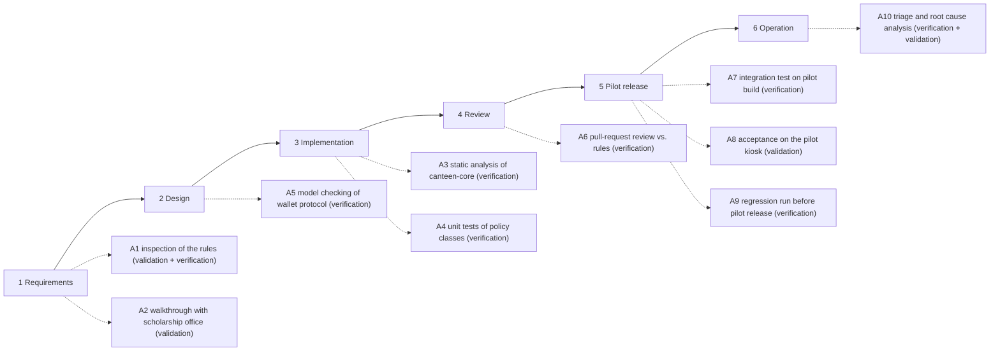

# Lab-01 Task 3: verification and validation in the ITC process<Student B></student>

Pair: KHEANG Lymeng, NAT Chamnan

## Activities (one row each)

| Id  | Activity                                                                                                                | Phase (earliest) | Verification or validation                                                                                                                                                                                                                                             | Artefact checked                                                                                                         | Checked against                                                                                                                   |
| --- | ----------------------------------------------------------------------------------------------------------------------- | ---------------- | ---------------------------------------------------------------------------------------------------------------------------------------------------------------------------------------------------------------------------------------------------------------------- | ------------------------------------------------------------------------------------------------------------------------ | --------------------------------------------------------------------------------------------------------------------------------- |
| A1  | Inspection of the numbered rules with a boundary checklist (every "within", "before", "until": inclusive or exclusive?) | 1 Requirements   | validation of each rule against the workshop notes; verification of the rules against each other (consistency)                                                                                                                                                         | rules SUB-1, REF-1, TOP-1, PUR-1, SET-1                                                                                  | workshop notes; the other rules                                                                                                   |
| A2  | Walkthrough of rule SUB-1 with the scholarship office                                                                   | 1 Requirements   | validation — the written rule SUB-1 is walked through with the scholarship office to confirm it matches what they actually need (people's needs, not another document)                                                                                                | rule SUB-1                                                                                                               | the scholarship-office staff's understanding of the subsidy policy                                                                |
| A3  | Static analysis of canteen-core for null dereferences and data races                                                    | 3 Implementation | verification — the compiled canteen-core source is checked against language rules and concurrency correctness models (not people)                                                                                                                                     | the canteen-core source code (all policy and service classes)                                                            | null-safety rules and the Java memory model (data-race rules)                                                                     |
| A4  | Unit tests of each policy class, derived from the numbered rules                                                        | 3 Implementation | verification — each policy class output is compared against the clause it was derived from (a written rule, not a person's opinion)                                                                                                                                   | `SubsidyPolicy`, `RefundPolicy`, `TopUpPolicy`, `DailyLimitPolicy`                                               | rules SUB-1, REF-1, TOP-1, PUR-1 (the numbered rule each test was derived from)                                                   |
| A5  | Model checking of the wallet protocol (kiosk and app on one wallet)                                                     | 2 Design         | verification — the wallet protocol model is checked against the safety property "balance never goes negative and no double charge" (a written property, not people)                                                                                                   | the wallet protocol model (state machine of `Wallet.charge` / `Wallet.credit` under concurrent kiosk and app access) | the safety properties: balance ≥ 0 at all times; each meal charged exactly once                                                  |
| A6  | Review of every pull request against the rules it implements                                                            | 4 Review         | verification — each PR diff is compared with the specific written rule it claims to implement                                                                                                                                                                         | the pull-request diff (changed classes and tests)                                                                        | the numbered rule(s) the PR references (e.g. rule SUB-1 for `SubsidyPolicy` changes)                                            |
| A7  | Integration test of kiosk, API and core on the pilot build                                                              | 5 Pilot release  | verification — the integrated pilot build is checked against the written acceptance criteria / rules (not people); validation is not done here because the canteen manager is not involved                                                                            | the pilot build on kiosk 1 (kiosk UI + REST API + canteen-core running together)                                         | the written integration acceptance criteria (end-to-end rule scenarios)                                                           |
| A8  | Acceptance test with the canteen manager on the pilot kiosk                                                             | 5 Pilot release  | validation                                                                                                                                                                                                                                                             | the pilot build on kiosk 1, with the real menu                                                                           | what the canteen manager needs at the counter                                                                                     |
| A9  | Regression run of all tests before every pilot release                                                                  | 5 Pilot release  | verification — the full Surefire test suite is re-run and compared against the expected pass/fail results recorded in the rules (no people involved)                                                                                                                  | the full canteen-core Surefire test suite (unit + integration tests)                                                     | the expected results defined by rules SUB-1, REF-1, TOP-1, PUR-1, SET-1 and the card state diagram                                |
| A10 | Triage and root cause analysis of each failure report                                                                   | 6 Operation      | both — verification: the failed behaviour is compared against the written rule or design model to pinpoint the defect; validation: the failure report is compared against what the pilot-kiosk users actually experienced to confirm the right problem is being fixed | each open failure report and the pilot-kiosk logs                                                                        | the written rule or design model (verification part); the description of real user impact in the failure report (validation part) |

## Diagram

## Earliest catch of a misread boundary in SUB-1

**Activity A2** (walkthrough of rule SUB-1 with the scholarship office, **Phase 1 Requirements**) would catch a misread boundary — for example, the lunch window written as `before(LUNCH_END)` when the scholarship office means `at or before` — earliest, because it brings the people who know the real policy into the room before any code or design work starts.

**Cost per iteration:** roughly **1–2 hours of one analyst or developer plus one scholarship-office staff member** per sprint in which SUB-1 is changed. That is the cheapest possible fix point: no code has been written yet, so the only cost is a short meeting and updating the rule document.

Catching the same boundary bug at A4 (unit tests, Phase 3) costs an additional **1–3 hours of a developer** to find, understand, fix, and re-test; at A7 (integration test, Phase 5) or A8 (acceptance, Phase 5) it costs **several hours of a developer, tester, and possibly the canteen manager**, plus a new build and re-deployment; in A10 (operation, Phase 6) it additionally involves **real student payments being wrongly subsidised or denied**, requiring data correction on top of the code fix.
